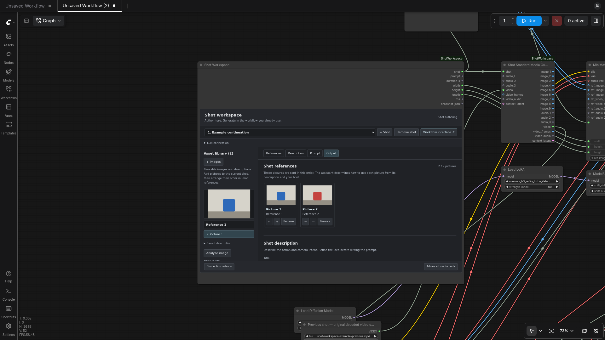

# ComfyUI Shot Workspace

Prepare references, refine shot descriptions and write H3 video prompts inside ComfyUI. Connect **Workflow Interface** to your existing generation workflow; that workflow continues to own models, context, sampling and decoding.

**Experimental release · 0.2.0.** Python 3.10+. [中文说明](README.zh-CN.md) · [Examples](examples/README.md) · [Connection guide](docs/WORKFLOW_INTERFACE.md)

## New: optional Director Storyboard

Turn a rough story into a complete shot plan, then apply the reviewed plan to Shot Workspace. The original manual-shot workflow remains available without this add-on.

1. Add **Director Storyboard (optional)** and connect its `storyboard` output to Shot Workspace's `storyboard` input.
2. Configure an OpenAI-compatible writing model in the director node. Enter a **Story** and click **Plan shots**; the model decides how many shots to propose.
3. Review the result, click **Use this plan**, then **Apply storyboard to connected workspace**. Applying replaces the connected workspace's shots while preserving its asset library; save any workflow you want to keep first.
4. In Shot Workspace, upload and analyse assets, select materials automatically, refine descriptions, write prompts and connect your existing video-generation workflow.

[Download the director skill ZIP](downloads/director-style-v2.2.4.zip), extract it, then use **Import skill folder** to select the `director-style` folder containing `SKILL.md`. Five authored director-inspired profiles plus a neutral baseline influence planning and description refinement only.

[Director skill guide](docs/DIRECTOR_SKILLS.md) · [Planning guide](docs/SCRIPT_PLANNING.md) · [Minimal add-on wiring example](examples/director-storyboard-addon.json)



## Install

Already have a working ComfyUI installation with Python 3.10+? Choose the commands for your installation below. You also need Git, or use **Code → Download ZIP** and follow the [ZIP/Desktop instructions](docs/INSTALL.md). The package needs `aiohttp>=3.9` and `Pillow>=10`, installed with **ComfyUI's Python**, not an unrelated system Python.

**Windows Portable — PowerShell in `ComfyUI_windows_portable`** (the folder containing `python_embeded`):

```powershell
git clone https://github.com/ai2764/ComfyUI-ShotWorkspace.git .\ComfyUI\custom_nodes\ComfyUI-ShotWorkspace
.\python_embeded\python.exe -m pip install -r .\ComfyUI\custom_nodes\ComfyUI-ShotWorkspace\requirements.txt
```

**Manual / venv / Conda installation — activate the environment that runs ComfyUI, then run from the ComfyUI directory**:

```sh
git clone https://github.com/ai2764/ComfyUI-ShotWorkspace.git custom_nodes/ComfyUI-ShotWorkspace
python -m pip install -r custom_nodes/ComfyUI-ShotWorkspace/requirements.txt
```

Restart ComfyUI completely and refresh the browser. Double-click an empty canvas area and search for **Shot Workspace (prototype)** (category: **Shot Workspace**). The installation should contain `custom_nodes/ComfyUI-ShotWorkspace/__init__.py` directly, without another nested repository folder.

**[Full installation, first-run setup and troubleshooting](docs/INSTALL.md)** · **[中文安装指南](docs/INSTALL.zh-CN.md)**

This installs the authoring node. Start an OpenAI-compatible model server separately for LLM functions; install the receiving workflow's community nodes and H3 weights separately for video generation. PyTorch and ComfyUI come from your existing installation. No model weights are bundled, and a successful LLM test does not validate video generation. Manager availability varies; the manual commands above do not require a Manager listing.

## Prepare a shot

**Optional add-on: [Director Storyboard](docs/SCRIPT_PLANNING.md).** Keep using Shot Workspace on its own, or connect the separate Director Storyboard node for rough-idea development, director guidance and whole-story planning. Review the plan, then explicitly apply it to the workspace. **Auto-select materials** remains available per shot in the original workspace.

1. Under **LLM connection**, enter an OpenAI-compatible URL and writing/vision model names. Start the model server separately, then click **Test connection** for real text and image requests.
2. Upload separate character, prop and scene assets. **Analyse image** produces an editable description; **Use description** saves it.
3. Select current-shot references in Picture order. Enter a description, refine it, then write and review the prompt. These three operations show separate elapsed times.
4. Click **Workflow interface ↗** to locate or add **Workflow Interface**, then connect prompt and ordered images to the receiving workflow. Connect a sampler and video saver before **Generate this shot**.

Examples include an authored prompt and neutral fixtures, so their generation path can be explored without first connecting an LLM. Changing shot/reference content makes a prompt stale; rewrite it or review and accept a current prompt.

Configure an API key **environment variable name**, never the secret itself. **Unload LLM before generation** is off by default; enabling it needs a provider-specific, same-origin unload URL. OpenAI-compatible inference does not standardize unloading.

## Example workflows

| Workflow | Purpose | Origin |
| --- | --- | --- |
| [Motion Context video](examples/verified/01-motion-context-video.json) | Previous VIDEO → components → context frames/audio | Compact validated integration from a Comfy-Org H3 template and NikoDemon80's nodes |
| [MultiRef latent context](examples/verified/02-multiref-latent-context.json) | Native latent chain; existing decode → standard VIDEO | seitanism's complete AV Extension canvas: 102 original nodes, 20 groups, plus 6 interface nodes |
| [Native H3 latent](examples/verified/03-motion-context-native-latent.json) | Native AV latent save/load handoff | Supplement to the Motion Context example |

[Install fixture inputs and follow setup](examples/README.md) before running. These graphs derive from completed local video runs; private media and configuration were replaced for redistribution. The public fixtures were then GPU-rendered through all three routes, including a native-latent first clip and continuation. Small output clips and hashes are included in `examples/results/`. See [verification scope](examples/VERIFICATION.md).

The compact Motion Context integration is **not** the author's full v0.7 graph. The [unchanged original](examples/upstream/motion-context/H3-Motion-Context-v0.7.json) and [original-layout connection reference](examples/reference/motion-context-original-connected.json) are provided separately. The latter is not a completed full-v0.7 inference claim.

## Boundaries

- One active shot runs per queue; there is no full-sequence orchestration.
- Select predecessors explicitly. Output previews do not automatically feed the next shot; no self-feedback graph loop is provided.
- Different LATENT formats are not interchangeable. Reuse the compatible native decoder and package images/audio as VIDEO across workflow boundaries.
- Writing currently binds images. Advanced AUDIO/VIDEO/LATENT ports pass explicit media through; they do not automatically add media to LLM prompts.
- Sampling duration precedes context trimming. H3 input frames follow the `17k+5` grid at 24 fps; delivered video can be shorter.
- Workflows save authoring data, filenames and server URLs; image bytes stay in ComfyUI's input directory. Review before sharing.
- Routes rely on ComfyUI's access control; this node does not add authentication to a publicly exposed server.

## Development

```sh
python -m pip install -r requirements.txt
python -X utf8 -m unittest discover -s tests -v
node --test tests/uuid.test.cjs tests/default-config.test.cjs tests/planning.test.cjs
```

Node.js 22+ is needed for JavaScript tests only. Native Torch tests skip outside a ComfyUI Torch environment. Minimal pinned JSON fixtures keep unit tests independent of private workspaces, GPU models and external APIs.

## License and credits

Original implementation, frontend and application authoring rules: [MIT](LICENSE). Upstream JSON and derived examples retain their original licenses, not the root MIT license. See [third-party notices](THIRD_PARTY_NOTICES.md).

Thanks to **NikoDemon80**, **seitanism**, **Comfy-Org**, **Zironic/H3-Optimizations**, and **VideoHelperSuite**. No community Python implementation or model weights are bundled.
